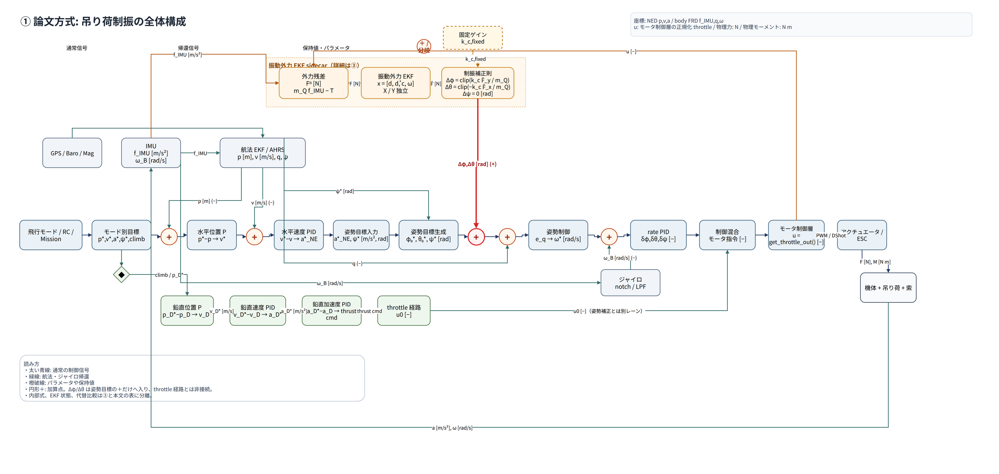
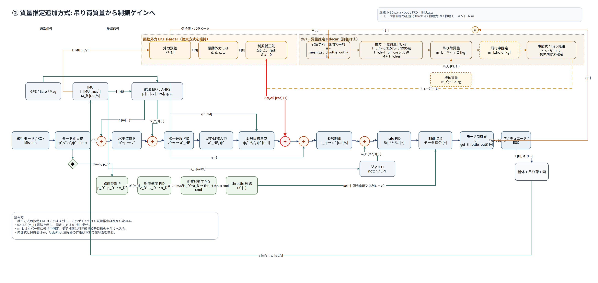
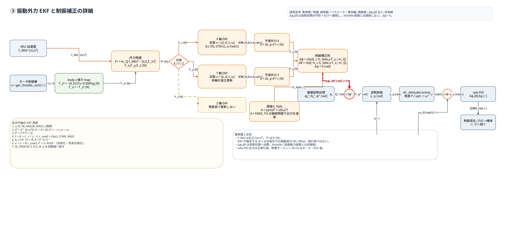
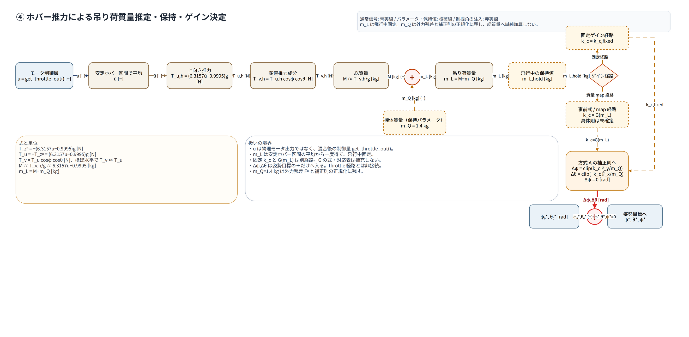

# ArduPilot 吊り荷制振の制御アーキテクチャ草稿

**状態:** 先生向けレビュー用の技術草稿。制御実装の妥当性、飛行安全性、追加方式の性能を証明する文書ではない。  
**対象実装:** `/home/taki/Ardupilot-UmemotoLab-ekf-V2` の `master`、commit `a8955e16234aa11d72fe03c26d9c76b7f0eb15af`。  
**対象論文:** `/home/taki/EKF-LogAnalyzer/paper/ISA_Trans_Submission/main.tex` と、そこから読み込まれる `chapters/ch2_modeling.tex`、`ch3_observer.tex`、`ch4_control.tex`、`ch6_discussion.tex`。

## 1. 目的と二つの方式

本稿は、標準的なマルチロータのカスケード制御、ArduPilot の位置・速度・姿勢・角速度制御、モータ混合、機体と吊り荷の力学を一つの信号経路として整理する。その上で、次の二方式を区別する。

| 方式 | 位置付け | 新規性・未確定点 |
|---|---|---|
| 方式 A: 論文方式 | IMU とスロットル指令から求めた外力残差に、周波数を状態に含む 4 状態 EKF を適用し、推定外力を roll/pitch の補正角へ変換する。 | 論文で記述・実験される方式。実装との細部の差は第 8 節に示す。 |
| 方式 B: 質量推定追加方式 | 離陸後の安定ホバー区間で取得したスロットル平均から吊り荷質量 \(m_L\) を一度推定し、飛行中固定して制振ゲインの決定に使う構想。 | 本稿で整理する追加設計。ゲイン則と飛行検証は未確定。 |

方式 B は方式 A の外力 EKF を質量推定器へ置き換える案ではない。外力 EKF は振動外力を扱い、質量推定器は安定ホバー時の正の鉛直推力から静的な総質量を扱う。二つは入力、状態、更新時刻、用途が異なる。

## 2. 座標、記号、単位

標準的な制御線図との対応には、PX4 の [Controller Diagrams](https://docs.px4.io/main/en/flight_stack/controller_diagrams) と ArduPilot の [Copter Attitude Control](https://ardupilot.org/dev/docs/apmcopter-programming-attitude-control-2.html) を参照する。ArduPilot の航法 EKF の役割は [Extended Kalman Filter overview](https://ardupilot.org/copter/docs/common-apm-navigation-extended-kalman-filter-overview.html)、推力曲線は [Motor Thrust Scaling](https://ardupilot.org/copter/docs/motor-thrust-scaling.html) を参照する。

| 記号 | 意味 | 単位・範囲 | 座標・備考 |
|---|---|---|---|
| \(p\) | 位置 | m | NED。\(p_N,p_E,p_D\) |
| \(v\) | 速度 | m/s | NED |
| \(a\) | 加速度目標または推定加速度 | m/s\(^2\) | NED。上向きは \(a_D<0\) |
| \(\phi,\theta,\psi\) | roll, pitch, yaw | rad | 姿勢角 |
| \(q\) | 機体姿勢 | 単位クォータニオン | 機体 FRD と NED の関係 |
| \(\omega^B\) | 機体角速度 | rad/s | body FRD の \(x,y,z\) 回り |
| \(f_{\mathrm{IMU}}\) | Observer が用いる IMU 加速度信号 | m/s\(^2\) | 論文では重力を含む IMU 出力の記法 |
| \(u\) | 混合後の正規化スロットル出力 | 通常 0 から 1 | 実装では `motors->get_throttle_out()` |
| \(T_z^B\) | body \(z\) 方向の推力 | N | body FRD。上向き推力は負 |
| \(T_u\) | 上向き推力の大きさ | N | \(T_u=-T_z^B=(6.3157u-0.9995)g\) |
| \(T_v\) | 推力の鉛直成分 | N | \(T_v=T_u\cos\phi\cos\theta\)。ほぼ水平ホバーで \(T_v\approx T_u\) |
| \(F^B\) | body 軸で扱う外力残差 | N | 吊り荷張力と空力などの残差 |
| \(\hat F^B\) | 振動外力 EKF の予測外力 | N | 振れ角ではない |
| \(k_c\) | 補正角ゲイン | s\(^2\)/m 相当 | 実装パラメータ `OBS_CORR_GAIN` |
| \(m_Q\) | 機体質量 | kg | 論文・Observer の力正規化に使う機体質量 |
| \(m_L\) | 吊り荷質量 | kg | 方式 B の推定対象。方式 A の必須入力ではない |
| \(M\) | 機体と吊り荷の総質量 | kg | 方式 B では \(M=m_Q+m_L\) とし、ホバー平衡から推定する |

座標系は次のように固定する。

- NED は \(x\) 北、\(y\) 東、\(z\) 下である。
- body FRD は \(x\) 前、\(y\) 右、\(z\) 下である。
- 水平制御は主に NED の位置・速度・加速度を使う。
- 姿勢制御は body 座標の角速度と、機体 FRD から NED への姿勢を使う。
- body \(z\) は下向き正である。推力 map は \(T_z^B=-(6.3157u-0.9995)g\) [N]、上向き推力の大きさは \(T_u=-T_z^B=(6.3157u-0.9995)g\) [N] である。
- 推力ベクトルが roll \(\phi\)、pitch \(\theta\) だけ傾くとき、鉛直成分は \(T_v=T_u\cos\phi\cos\theta\) [N] である。ほぼ水平なホバーでは \(T_v\approx T_u\) と近似する。

実装上の座標根拠は [AP_InertialSensor.cpp](/home/taki/Ardupilot-UmemotoLab-ekf-V2/libraries/AP_InertialSensor/AP_InertialSensor.cpp:417)、[AC_PosControl.h](/home/taki/Ardupilot-UmemotoLab-ekf-V2/libraries/AC_AttitudeControl/AC_PosControl.h:752) にある。`get_thrust_vector()` のコメントは body 座標の単位ベクトルと読めるが、関数本体は NED 加速度目標を返し、消費側で正規化する。本稿では関数本体と現在の呼出経路を基準にする。根拠は [AC_PosControl.cpp](/home/taki/Ardupilot-UmemotoLab-ekf-V2/libraries/AC_AttitudeControl/AC_PosControl.cpp:1373) と [AC_AttitudeControl.cpp](/home/taki/Ardupilot-UmemotoLab-ekf-V2/libraries/AC_AttitudeControl/AC_AttitudeControl.cpp:947)。

## 3. 作図ファイルと全体構成

編集可能な正本は [control_architecture.drawio](control_architecture.drawio) である。4 ページで、①論文方式全体、②質量推定追加方式全体、③振動外力 EKF と補正の詳細、④ホバー推力による質量推定・保持・ゲイン決定を分担する。

全図に共通する表現を次に固定する。

- 主経路は左から右へ、水平位置・速度 → 姿勢目標生成 → 姿勢目標の円形＋ → 姿勢誤差・姿勢制御 → rate PID → 混合・ESC → 機体の順に置く。
- 鉛直位置・速度・加速度 → throttle は別レーンとし、制御混合へ直接接続する。
- \(\Delta\phi,\Delta\theta\) は専用の赤い矢印で姿勢目標の円形＋だけへ入る。throttle 経路との交点や共用節点を持たない。\(\Delta\psi=0\) とする。
- 航法 EKF・AHRS の \(p,v,q\) 帰還と、IMU ジャイロから rate PID への帰還を別経路で示す。
- 通常信号は青実線、帰還は緑実線、保持値・パラメータは橙破線、補正角の注入は赤実線で示す。
- rate PID の出力は正規化値であり、物理モーメント [N m] はモータ・ESC 以降で発生する。

### 3.1 論文方式の全体図

### 3.2 質量推定追加方式の全体図

## 4. 共通制御系のブロックと内部アルゴリズム

### 4.1 信号表

| ブロック | 入力 | 出力 | 単位 | 内部アルゴリズム・実装上の意味 |
|---|---|---|---|---|
| 飛行モード・指令 | パイロット入力、ミッション、モード状態 | 位置・速度・姿勢・推力、または高度・上昇率の目標 | m, m/s, rad, 正規化値 | モードごとに位置制御の外側ループを使うか、姿勢・角速度・throttle 指令へ直接入るかを選択する。 |
| 軌道整形 | 生の位置・速度・加速度目標 | 制限付き位置・速度・加速度目標 | m, m/s, m/s\(^2\) | 最大速度、加速度、jerk を考慮して目標を滑らかにする。 |
| 位置制御 | \(p^*\), \(p\), 速度 feedforward、offset | \(v^*\) | m/s | 水平は P 制御、鉛直も P 制御を基礎とする。実装では target offset、terrain、feedforward を加える。 |
| 速度制御 | \(v^*\), \(v\), 加速度 feedforward、offset | \(a^*\) | m/s\(^2\) | 水平と鉛直に PID を用いる。飽和時は積分器と limit 情報を考慮する。 |
| 水平加速度 → 姿勢 | NED の \(a_N^*,a_E^*\), yaw | roll/pitch 目標 | rad | NED から前後・左右加速度へ回転し、\(\tan^{-1}(a/g)\) で lean angle を求める。 |
| 推力方向生成 | \(a_N^*,a_E^*\) | NED 推力方向 \([a_N^*,a_E^*,-g]\) | m/s\(^2\) | 水平加速度を保ち、\(z\) 成分を \(-g\) にする。姿勢制御側で方向を正規化する。 |
| 姿勢目標生成 | 傾き目標、yaw、推力方向 | \(\phi_0^*,\theta_0^*,\psi^*,q_0^*\) | rad, クォータニオン | 並進制御の加速度目標を基本姿勢目標へ変換する。補正角はまだ加えない。 |
| 鉛直加速度制御 | \(a_D^*\), 重力補償済み加速度、hover throttle | throttle | 正規化値 | 鉛直加速度 PID の出力から hover throttle を差し引き、符号反転後に angle boost を適用する。 |
| 補正角加算 | \(\phi_0^*,\theta_0^*\)、\(\Delta\phi,\Delta\theta\) | \(\phi^*=\phi_0^*+\Delta\phi\), \(\theta^*=\theta_0^*+\Delta\theta\) | rad | 振動外力 EKF の補正角を姿勢目標へ一時加算する。yaw は変更しない。 |
| 姿勢制御 | 有効姿勢目標 \(q^*\)、現在姿勢 \(q\)、角速度 feedforward | body 角速度目標 | rad/s | 姿勢誤差を P または sqrt controller で角速度へ変換し、feedforward と上限処理を加える。 |
| 角速度 PID | 角速度目標、ジャイロ角速度 | \(\delta_\phi,\delta_\theta,\delta_\psi\) | 正規化値 | 各 body 軸の PID。物理モーメントではなく、制御混合への正規化 rate 出力を渡す。 |
| 制御混合 | \(\delta_\phi,\delta_\theta,\delta_\psi\)、throttle、フレーム係数 | 各モータ指令 | 正規化値 | 各モータの roll/pitch/yaw/throttle factor を合成し、出力範囲に収まるようスケーリングする。 |
| 推力スケーリング | 各モータ推力指令 | アクチュエータ指令 | 正規化値、PWM、DShot など | ArduPilot の thrust expo、電圧・気圧補償などを通す。 |
| モータ制御層 | 各モータ指令、throttle、制限状態 | アクチュエータ指令、\(u=\texttt{get\_throttle\_out()}\) | 正規化値 | Observer と質量推定が参照する混合後 throttle を保持する。物理出力そのものではない。 |
| モータ・ESC | アクチュエータ指令 | 推力・モーメント | N, N m | アクチュエータ応答、回転数、推力曲線を経て機体へ加わる。 |
| 機体・吊り荷 | 合力・モーメント、索の張力 | \(p,v,q,\omega\) | SI | 機体と吊り荷の連成振動。吊り荷張力は機体への外力として作用する。 |
| 航法 EKF・AHRS | IMU、GPS、気圧、地磁気、必要に応じ外部測位 | \(p,v,q\) | SI | 複数センサを融合し、位置・速度・姿勢を推定する。 |
| 外力残差計算 | \(f_{\mathrm{IMU}}\), \(u\), \(m_Q\) | \(F^B\) | N | 推力 map と IMU 加速度から残差を計算する。 |
| 振動外力 EKF | 各軸の外力残差 \(z\) | \(\hat d,\hat{\dot d},\hat c,\hat\omega\) | N, N/s, N, rad/s | 振動成分、その微分、DC offset、周波数を推定する。 |
| 補正角 | \(\hat F_x^B,\hat F_y^B,k_c,m_Q\) | \(\Delta\phi,\Delta\theta\) | rad | 外力を角度へ変換し、最大角で clip する。 |
| 方式 B 質量推定 | 安定ホバー区間の平均 \(\bar u\)、\(\phi,\theta\)、\(m_Q\) | \(m_L\) | kg | 推力 map から \(T_u\) と \(T_v\) を求め、\(M\approx T_v/g\)、\(m_L=M-m_Q\) とする。 |
| 方式 B 固定ゲイン経路 | 固定パラメータ | \(k_c=k_{c,\mathrm{fixed}}\) | 補正角則に応じる | 質量推定を使わず固定ゲインを選択する経路である。 |
| 方式 B 質量 map 経路 | 飛行中固定の \(m_L\) | ゲイン補正 | 未確定 | 事前式または map を使う構想。具体則は未定義である。 |

### 4.2 位置・速度・加速度から姿勢と推力へ

水平方向の代表式は、実装を読むための簡略表現である。offset、terrain、AHRS scale、system ID の disturbance は除く。

$$
e_p=p^*-p,\qquad
v^*=K_{p,\mathrm{pos}}e_p+v_{\mathrm{ff}}
$$

$$
a_\mathrm{corr}=K_{p,\mathrm{vel}}(v^*-v)+K_{i,\mathrm{vel}}\int(v^*-v)\,dt
+K_{d,\mathrm{vel}}\frac{d(v^*-v)}{dt}
$$

$$
a^*=a_\mathrm{corr}+a_{\mathrm{ff}}
$$

\(a^*\) は最大 lean angle に基づく加速度上限で制限される。yaw \(\psi\) を使い、NED 加速度を body の前後・左右成分へ回す。

$$
a_f=a_N^*\cos\psi+a_E^*\sin\psi,\qquad
a_r=-a_N^*\sin\psi+a_E^*\cos\psi
$$

$$
\theta^*=\operatorname{atan2}(-a_f,g),\qquad
\phi^*=\operatorname{atan2}(a_r\cos\theta^*,g)
$$

この順序と符号は [AC_PosControl.cpp](/home/taki/Ardupilot-UmemotoLab-ekf-V2/libraries/AC_AttitudeControl/AC_PosControl.cpp:1614) の実装に対応する。速度 PID と目標合成は同ファイルの [水平制御](/home/taki/Ardupilot-UmemotoLab-ekf-V2/libraries/AC_AttitudeControl/AC_PosControl.cpp:715) にある。

鉛直方向では、位置 P が速度目標を作り、速度 PID が加速度目標を作る。

$$
e_D=p_D^*-p_D,\qquad
v_D^*=K_{p,D}e_D+v_{D,\mathrm{ff}}
$$

$$
a_D^*=K_{p,Dv}(v_D^*-v_D)+K_{i,Dv}\int(v_D^*-v_D)\,dt
+a_{D,\mathrm{ff}}
$$

鉛直加速度 PID は、重力補償済みの加速度と \(a_D^*\) の差から throttle 相当の加速度を作る。hover throttle を差し引き、最終 throttle を `set_throttle_out()` へ渡す。根拠は [AC_PosControl.cpp](/home/taki/Ardupilot-UmemotoLab-ekf-V2/libraries/AC_AttitudeControl/AC_PosControl.cpp:1098) と [同ファイルの angle boost 適用](/home/taki/Ardupilot-UmemotoLab-ekf-V2/libraries/AC_AttitudeControl/AC_AttitudeControl_Multi.cpp:365)。

### 4.3 姿勢制御と角速度制御

姿勢制御は、補正後の有効姿勢目標 \(q_\mathrm{eff}\) と現在姿勢 \(q\) の回転誤差を作り、roll/pitch/yaw の角速度目標へ変換する。

$$
\omega^*=K_\mathrm{att}e_q+\omega_{\mathrm{ff}}
$$

ここで \(e_q\) は推力方向と heading の回転誤差、\(K_\mathrm{att}\) は角度 P または sqrt controller を表す。角速度上限を適用した後、角速度 PID が各 body 軸の制御値を計算する。補正角は `_attitude_target` に累積せず、一時的な `effective_target` に加算される。根拠は [AC_AttitudeControl.cpp](/home/taki/Ardupilot-UmemotoLab-ekf-V2/libraries/AC_AttitudeControl/AC_AttitudeControl.cpp:1002)。

角速度制御は概念的には次式で表せる。

$$
\delta_{r,\phi}=K_{p,\omega,\phi}e_\phi
+K_{i,\omega,\phi}\int e_\phi\,dt
+K_{d,\omega,\phi}\frac{de_\phi}{dt},
\quad[-]
$$

ここで \(e_\phi=\omega_\phi^*-\omega_\phi\) である。上式は roll 軸の表記例であり、\(\delta_{r,\phi}\) は制御混合へ渡す正規化 rate 出力であって物理モーメントではない。roll/pitch/yaw の同じ計算を行い、PID 出力を `set_roll()`、`set_pitch()`、`set_yaw()` へ渡す。混合とモータ・ESC を経た後に物理モーメント [N m] が発生する。根拠は [AC_AttitudeControl_Multi.cpp](/home/taki/Ardupilot-UmemotoLab-ekf-V2/libraries/AC_AttitudeControl/AC_AttitudeControl_Multi.cpp:457)。

### 4.4 混合、モータ、機体と吊り荷

マルチコプタの混合は、各モータ \(i\) について roll、pitch、yaw、throttle の係数を合成する。

$$
u_i=u+\alpha_i\delta_\phi+\beta_i\delta_\theta+\gamma_i\delta_\psi
$$

\(u_i\) は出力範囲に収まるようスケールされ、モータ制御層で推力曲線や電圧補償を経て各 ESC の指令へ変換される。モータとプロペラが発生する物理量は力 [N] とモーメント [N m] である。機体と吊り荷の運動は、索張力を総質量の重力と二重計上せず、各物体の外力として分けて書く。

$$
\mathbf T^I=R_{B\to I}
\begin{bmatrix}0\\0\\-T_u\end{bmatrix},\qquad
m_Q\dot v_Q^I
=m_Q\mathbf g^I+\mathbf T^I+\mathbf F_c^I+\mathbf F_\mathrm{aero,Q}^I
$$

$$
m_L\dot v_L^I
=m_L\mathbf g^I-\mathbf F_c^I+\mathbf F_\mathrm{aero,L}^I
$$

ここで \(R_{B\to I}\) は body から inertial への回転、\(\mathbf F_c^I\) は機体に作用する索張力、\(\mathbf F_\mathrm{aero,Q}^I\) と \(\mathbf F_\mathrm{aero,L}^I\) はそれぞれ機体と吊り荷の空力外力である。索を介した機体・吊り荷の相互作用は \(\mathbf F_c^I\) として別々の物体方程式に現れる。総質量 \(M=m_Q+m_L\) の式へ索張力を加えて重力を二重計上しない。混合の実装根拠は [AP_MotorsMatrix.cpp](/home/taki/Ardupilot-UmemotoLab-ekf-V2/libraries/AP_Motors/AP_MotorsMatrix.cpp:220) と [同ファイル](/home/taki/Ardupilot-UmemotoLab-ekf-V2/libraries/AP_Motors/AP_MotorsMatrix.cpp:390)。

## 5. 方式 A: 論文の振動外力 EKF

### 5.1 詳細図

Reference figure: モータ制御層の \(u\) と IMU 加速度から振動外力 EKF を構成し、補正角を基礎姿勢目標へ加算して既存の姿勢・角速度・モータ制御へ入れる詳細図である。\(z\) 軸は現実装で EKF 更新から除外されるため、破線で示す。

編集可能な図は [draw.io 第3ページ](control_architecture.drawio) を参照する。

### 5.2 外力残差の計算

論文は body 座標で次式を定義する。

$$
F_{\mathrm{payload}}+F_{\mathrm{aero}}
=m_Qf_{\mathrm{IMU}}-T
$$

論文では \(T=(K_\mathrm{scale}u+K_\mathrm{offset})g\) と記述される。実装では body \(z\) が下向き正なので、同じ測定由来 map を符号付きで次式のように使う。右辺の係数は推力に換算済みであり、\(T_z^B\) と \(T_u\) の単位は N である。

$$
T_z^B=-(6.3157u-0.9995)g,\qquad
T_u=-T_z^B=(6.3157u-0.9995)g
$$

$$
T_v=T_u\cos\phi\cos\theta
$$

Observer の残差は、実装に合わせて概念的に次式で表す。

$$
F_x^B=m_Qf_{\mathrm{IMU},x},\qquad
F_y^B=m_Qf_{\mathrm{IMU},y},\qquad
F_z^B=m_Qf_{\mathrm{IMU},z}-T_z^B
$$

\(F^B\) は吊り荷張力だけではなく、空力、センサ誤差、推力モデル誤差などを含む合成残差である。EKF が推定する \(d+c\) は、この合成残差の振動成分と DC offset である。振れ角 \(\phi_L,\theta_L\) を直接推定するものではない。論文の定義は [ch2_modeling.tex](/home/taki/EKF-LogAnalyzer/paper/ISA_Trans_Submission/chapters/ch2_modeling.tex:8)、実装の計算は [AP_Observer.cpp](/home/taki/Ardupilot-UmemotoLab-ekf-V2/libraries/AP_Observer/AP_Observer.cpp:448) にある。

### 5.3 4 状態 EKF

\(X\) 軸と \(Y\) 軸について、各軸に独立した状態を置く。

$$
x=[d,\ \dot d,\ c,\ \omega]^\mathsf T
$$

| 状態 | 意味 | 単位 |
|---|---|---|
| \(d\) | 周期的な外力成分。仮想的な調和振動子の位置として扱う。 | N |
| \(\dot d\) | \(d\) の時間微分 | N/s |
| \(c\) | DC offset。定常外力、バイアス、モデル誤差を吸収する。 | N |
| \(\omega\) | 未知の角周波数 | rad/s |

連続時間モデルは \(\ddot d=-\omega^2d\)、観測モデルは次式である。

$$
z_k=d_k+c_k,\qquad H=[1,0,1,0]
$$

実装の symplectic Euler 予測は次式である。

$$
\dot d_k^-=\dot d_{k-1}-\Delta t\,\omega_{k-1}^2d_{k-1}
$$

$$
d_k^-=d_{k-1}+\Delta t\,\dot d_k^-
$$

\(c_k^-=c_{k-1}\)、\(\omega_k^-=\omega_{k-1}\) とし、観測予測を \(\hat z_k=d_k^-+c_k^-\)、innovation を \(r_k=z_k-\hat z_k\) とする。

実装の EKF 更新は、概念的に次の順序で行う。

1. \(P^-=FPF^\mathsf T+Q\) を計算する。
2. \(S=HP^-H^\mathsf T+R\) を計算する。
3. \(K=P^-H^\mathsf TS^{-1}\) を計算する。
4. innovation を \([-r_{\max},r_{\max}]\) に clip する。
5. \(x^+=x^-+Kr_{\mathrm{used}}\) で状態を更新する。
6. \(P^+=(I-KH)P^-\) を計算し、対称化と非負対角化を行う。
7. \(\omega\) の freeze が指定されていれば、更新後の \(\omega\) を初期値へ戻す。

\(\Delta t\) は 0.001 秒から 0.05 秒へ制限される。実装では \(X\) 軸と \(Y\) 軸だけを更新し、\(Z\) 軸は CPU 節約と発散抑制のため `continue` する。根拠は [AP_Observer.cpp](/home/taki/Ardupilot-UmemotoLab-ekf-V2/libraries/AP_Observer/AP_Observer.cpp:259)。

### 5.4 予測外力と補正角

Observer は予測時間 \(\Delta t_p\) だけ進めた \(d+c\) を補正に使う。

$$
\hat F(t+\Delta t_p)\approx d+\Delta t_p\dot d+c
$$

補正角は実装では次の形になる。

$$
\Delta\phi=\operatorname{clip}
\left(\frac{k_c\,G_{\mathrm{fade},y}\hat F_y^B}{m_Q},
-\theta_{\max},\theta_{\max}\right)
$$

$$
\Delta\theta=\operatorname{clip}
\left(\frac{-k_c\,G_{\mathrm{fade},x}\hat F_x^B}{m_Q},
-\theta_{\max},\theta_{\max}\right)
$$

\(\Delta\psi=0\) である。補正角は既存の姿勢目標に加算され、同じ姿勢・角速度・モータ制御を通って機体へ作用する。根拠は [AP_Observer.cpp](/home/taki/Ardupilot-UmemotoLab-ekf-V2/libraries/AP_Observer/AP_Observer.cpp:500) と [Copter.cpp](/home/taki/Ardupilot-UmemotoLab-ekf-V2/ArduCopter/Copter.cpp:956)。

振幅の fade 判定は次式である。

$$
A=\sqrt{d^2+\left(\frac{\dot d}{\omega}\right)^2}
$$

\(A\) がしきい値未満の時間を計時し、一定遅延後に補正角の寄与を滑らかに 0 へ近づける。これは振動が小さいときの制御介入を抑える処理であり、質量推定とは独立している。

### 5.5 保持パラメータ

| コード名 | 意味 | 実装既定値 | 単位 | 保持先 |
|---|---|---:|---|---|
| `OBS_CORR_GAIN` | 外力から補正角へのゲイン \(k_c\) | 0.0 | s\(^2\)/m 相当 | AP Parameter |
| `OBS_EKF_Q_D` | \(d\) の process noise | \(9.5367432\times10^{-12}\) | 状態に応じる | AP Parameter |
| `OBS_EKF_Q_DD` | \(\dot d\) の process noise | \(2.3841858\times10^{-11}\) | 状態に応じる | AP Parameter |
| `OBS_EKF_Q_C` | \(c\) の process noise | \(4.7683716\times10^{-13}\) | 状態に応じる | AP Parameter |
| `OBS_EKF_Q_W` | \(\omega\) の process noise | 0.0005 | 状態に応じる | AP Parameter |
| `OBS_EKF_R_MEAS` | 外力残差の観測 noise variance | 46.0 | N\(^2\) | AP Parameter |
| `OBS_EKF_W_INIT` | 初期角周波数 | 3.7699 | rad/s | AP Parameter |
| `OBS_EKF_W_MIN` | 最小角周波数 | 2.1991 | rad/s | AP Parameter |
| `OBS_EKF_W_MAX` | 最大角周波数 | 5.7180 | rad/s | AP Parameter |
| `OBS_PRED_TIME` | 外力予測時間 \(\Delta t_p\) | 0.00 | s | AP Parameter |
| `OBS_MAX_CORR_ANG` | roll/pitch 補正角上限 | 0.5 | rad | AP Parameter |
| `OBS_EKF_INN_MAX` | innovation clip 幅 | 0.70 | N | AP Parameter |
| `OBS_W_FREEZE` | \(\omega\) を初期値に固定する比較用スイッチ | 0 | 0/1 | AP Parameter |

コード上の \(g=9.7985\ \mathrm{m/s^2}\)、`THRUST_SCALE=6.3157`、`THRUST_OFFSET=-0.9995`、`UAV_mass=1.4 kg`、EKF 初期共分散 10.0 は定数として保持される。根拠は [AP_Observer.h](/home/taki/Ardupilot-UmemotoLab-ekf-V2/libraries/AP_Observer/AP_Observer.h:192) と [AP_Observer.cpp](/home/taki/Ardupilot-UmemotoLab-ekf-V2/libraries/AP_Observer/AP_Observer.cpp:5)。

## 6. 方式 B: 安定ホバー後の吊り荷質量推定

### 6.1 詳細図

Reference figure: 安定ホバー区間の平均 throttle から上向き推力、鉛直推力成分、総質量、吊り荷質量を求め、飛行中固定する構想を示す。固定ゲイン経路と質量 map 経路を分けて示す。

編集可能な図は [draw.io 第4ページ](control_architecture.drawio) を参照する。

### 6.2 アルゴリズム

1. 離陸後の安定ホバー区間で、混合後のスロットル出力 \[
   u(t)=\texttt{motors->get\_throttle\_out()}
   \] を平均し、\(\bar u\) を得る。
2. 推力 map から上向き推力の大きさを計算する。

   $$
   T_{u,h}=-T_{z,h}^B=(6.3157\bar u-0.9995)g\quad[\mathrm N]
   $$

3. 推力方向の roll \(\phi\)、pitch \(\theta\) を使って鉛直成分を求める。

   $$
   T_{v,h}=T_{u,h}\cos\phi\cos\theta\quad[\mathrm N]
   $$

   ほぼ水平なホバーでは \(T_{v,h}\approx T_{u,h}\) である。

4. 鉛直平衡 \(T_{v,h}\approx Mg\) から総質量を求める。

   $$
   M\approx\frac{T_{v,h}}{g}\approx 6.3157\bar u-0.9995\quad[\mathrm{kg}]
   $$

5. 既知または校正済みの機体質量 \(m_Q\) を減算して吊り荷質量を得る。

   $$
   m_L=M-m_Q\quad[\mathrm{kg}]
   $$

6. \(m_L\) を飛行中の固定値として保持する。
7. 固定ゲイン経路では \(k_c=k_{c,\mathrm{fixed}}\) を使う。質量 map 経路では、事前に定式化した関数 \(k_c=f_g(m_L)\) または質量からゲインへの map を使う。具体則は本草稿で定義しない。

### 6.3 この追加方式で確定していることと未確定のこと

| 項目 | 状態 |
|---|---|
| 質量推定対象 | 吊り荷 \(m_L\) |
| 推力 map | \(T_z^B=-(6.3157u-0.9995)g\) [N] |
| 上向き推力 | \(T_u=-T_z^B=(6.3157u-0.9995)g\) [N] |
| 鉛直推力成分 | \(T_v=T_u\cos\phi\cos\theta\) [N]、ほぼ水平で \(T_v\approx T_u\) |
| 取得信号 | \(u=\texttt{get\_throttle\_out()}\) |
| 推定タイミング | 離陸後の安定ホバー区間で平均 |
| 質量式 | \(M\approx T_{v,h}/g\approx 6.3157\bar u-0.9995\)、\(m_L=M-m_Q\) |
| 飛行中の扱い | \(m_L\) を固定し、制振ゲイン決定に使う |
| ゲイン経路 | 固定ゲイン \(k_{c,\mathrm{fixed}}\) と、\(m_L\) を使う事前式・map を別経路として扱う |
| ゲイン則 | 質量 map の具体式・対応表は未定義 |
| 外力 EKF の質量項 | 外力残差と補正角則の正規化には \(m_Q\) を使う |
| 有効範囲 | 推力 map、ホバー条件、積載、電圧、空力、フレーム差に対する一般性は未検証 |

質量推定は、推力 map の再現性を条件とするホバー平衡の推定である。\(u\) は物理モータ出力ではなく混合後の制御量であるため、別のフレーム、混合設定、電圧補償へ同じ map をそのまま適用できるとは限らない。

方式 B のゲイン則について、比例則や実験結果をこの草稿では仮定しない。論文の既存実験では固定ゲイン \(k_c=0.3\) が 0.471 kg で悪化したことが報告されているが、これは方式 A の限られた条件での結果であり、方式 B のゲイン則の検証結果ではない。根拠は [ch5_experiments.tex](/home/taki/EKF-LogAnalyzer/paper/ISA_Trans_Submission/chapters/ch5_experiments.tex:242) と [同ファイルの結果](/home/taki/EKF-LogAnalyzer/paper/ISA_Trans_Submission/chapters/ch5_experiments.tex:280)。

## 7. 振動 EKF の採用理由と推定器代替比較

### 7.1 採用理由

方式 A の観測量は、吊り荷張力だけの角度ではなく、IMU とスロットル指令から得た外力残差である。この残差は DC offset と周期成分を含み、索長が既知でない場合には周期成分の周波数も未知になる。そこで、次の四点がこの用途に合う。

1. 外力残差を \(d+c\) としてモデル化でき、振れ角の直接計測や索長を必要としない。
2. 角周波数 \(\omega\) を状態としてオンライン更新でき、固定周波数 KF より未知の索長変化へ対応できる。
3. 各水平軸が 4 状態なので、非線形な球面振子全体を推定するより状態数と計算量を抑えられる。
4. innovation clipping と振幅 fade を組み合わせ、突発的な外力と振動収束後の小さな残差を扱える。

論文でも、周波数を状態に含めることで索長の事前知識を不要にし、外力推定が吊り荷質量を陽に含まないことを設計上の利点としている。根拠は [ch3_observer.tex](/home/taki/EKF-LogAnalyzer/paper/ISA_Trans_Submission/chapters/ch3_observer.tex:4) と [ch6_discussion.tex](/home/taki/EKF-LogAnalyzer/paper/ISA_Trans_Submission/chapters/ch6_discussion.tex:8)。

### 7.2 代替手法

| 推定器 | 推定対象 | 利点 | 用途上の限界 | 本問題での位置付け |
|---|---|---|---|---|
| 方式 A: 周波数状態付き振動 EKF | 各水平軸の振動外力、DC offset、角周波数 | 力の調和モデルが小さく、未知周波数をオンライン推定できる。外乱角度センサ不要。 | 線形振子近似、十分な励振、DC/周期信号の分離を前提とする。短期間の周波数推定には process noise の調整が必要。 | 現在の方式 A の主推定器。 |
| 固定 \(\omega\) KF | 既知周波数の振動外力と DC offset | 状態数と調整項目が少なく、計算量が小さい。 | 索長変更、吊り荷交換、周波数ドリフトに弱い。固定値が外れると位相と振幅の推定が崩れる。 | 比較用・既知索長のベースライン。実装の `OBS_W_FREEZE` はこの比較に使える。 |
| 非線形振子 EKF | 機体・吊り荷位置、振れ角、角速度、必要なら索長 | 球面振子の非線形性を表現しやすい。振れ角まで推定できる。 | 状態次元とヤコビアンが増える。索長、張力、空力、質量などのモデルと初期値に依存しやすい。 | 外乱角度や索長を直接状態に含める設計との比較候補。 |
| UKF | 非線形振子の状態・未知パラメータ | ヤコビアンを陽に近似せず、シグマ点で非線形変換を扱う。 | 状態数に応じて予測点と計算量が増える。ノイズ設定と初期分布に敏感で、組み込みでの反復検証が必要。 | 強い非線形性を扱う代替候補だが、現行の小さな調和モデルより重い。MATLAB の公式資料として [Nonlinear State Estimation Using UKF and Particle Filter](https://www.mathworks.com/help/control/ug/nonlinear-state-estimation-using-unscented-kalman-filter.html) を参照。 |
| 適応周波数推定器 | 周波数のみ、または周波数と外力位相 | 周波数へ焦点を当て、振子モデルを小さくできる。 | 位相・振幅・DC offset をどのように分離するかが必要。周波数更新則、励振条件、複数モードへの誤収束の扱いが課題になる。 | \(\omega\) 推定の代替候補。具体アルゴリズムは本実装に未導入。 |
| FFT・短時間 FFT | 観測窓内の卓越周波数 | 既知長の窓における周波数成分を直接評価しやすい。 | 周波数分解能と時間分解能が窓長で制約される。位相・DC offset・非定常性を直接連続推定する用途には向かない。 | 実験では EKF 周波数の評価基準として使う。MATLAB 公式 [FFT](https://www.mathworks.com/help/signal/ref/fft.html) を参照。 |
| ESO | 集中外乱とその微分の推定 | モデル誤差をまとめて推定でき、制御設計へ接続しやすい。 | 外乱を集中項として扱うため、振れ周波数の識別や調和成分の分離を必ず行うわけではない。帯域とゲインのトレードオフがある。 | 制御向けの代替・補助候補。論文で比較される Cai et al. の ESO 系研究は [DOI: 10.1038/s41598-026-38931-8](https://doi.org/10.1038/s41598-026-38931-8)。 |
| ホバー推力からの質量推定 | 吊り荷質量の静的な値 | 追加センサや振れ角センサを要さず、安定ホバー区間の平均 throttle から総質量を推定できる。 | 推力 map、積載、電圧、空力、地面効果に依存する。振動周波数や外力位相は推定しない。 | 方式 B の独立した補助推定器。方式 A の振動 EKF を置換しない。 |

### 7.3 推定対象の境界

| 量 | 方式 A の振動 EKF | 方式 B の質量推定 |
|---|---|---|
| 機体位置・速度・姿勢 | 直接推定しない。航法 EKF が担当する。 | 直接推定しない。 |
| 吊り荷の振れ角 | 直接推定しない。 | 推定しない。 |
| 吊り荷張力と空力の合成振動外力 | 推定する。 | 推定しない。 |
| 吊り荷質量 | 必須入力ではなく、陽には推定しない。 | 安定ホバー時の推力から推定する。 |
| 索長・振子周波数 | 周波数 \(\omega\) をオンライン推定する。索長は直接推定しない。 | 推定しない。 |
| 更新時刻 | 100 Hz の飛行中更新 | 離陸後の安定ホバーで一度推定し、飛行中固定する構想。 |
| 制御への用途 | 外力から補正角を計算する。 | 質量から制振ゲイン候補を決める。 |

## 8. 現行実装と論文記述の差

| 項目 | 論文・論文図 | 現行実装 | 読むときの区別 |
|---|---|---|---|
| EKF の軸 | 論文は \(X,Y\) 軸を独立に推定する。 | [AP_Observer.cpp](/home/taki/Ardupilot-UmemotoLab-ekf-V2/libraries/AP_Observer/AP_Observer.cpp:273) は \(X,Y\) を更新し、\(Z\) を更新しない。 | 質量推定は \(Z\) 軸推力を使うが、振動 EKF の \(Z\) 外力を使用しない。 |
| ヤコビアン | 論文式は symplectic Euler 後の \(1-\Delta t^2\omega^2\) と \(-2\Delta t^2\omega d\) を含む。 | [実装の F](/home/taki/Ardupilot-UmemotoLab-ekf-V2/libraries/AP_Observer/AP_Observer.cpp:309) は \(F_{00}=1\)、\(F_{03}=0\) の近似を持つ。 | 状態遷移自体は一致するが、共分散予測のヤコビアンは一致しない。本文では実装式と論文式を分ける。 |
| IMU フィルタ | 論文は flight controller の低域フィルタを通した \(f_\mathrm{IMU}\) を使う。 | [Observer](/home/taki/Ardupilot-UmemotoLab-ekf-V2/libraries/AP_Observer/AP_Observer.cpp:455) の `_payload_filter` は無効で、`AP::ins().get_accel()` の値をそのまま入力する。 | 外側の IMU 処理は別にあるが、Observer 内の明示的 LPF は使っていない。 |
| 補正の結合方法 | 論文本文は補正クォータニオンを姿勢目標へ掛けると記述する。 | 実装の飛行経路は [set_correction_euler()](/home/taki/Ardupilot-UmemotoLab-ekf-V2/ArduCopter/Copter.cpp:963) を使い、[姿勢制御内](/home/taki/Ardupilot-UmemotoLab-ekf-V2/libraries/AC_AttitudeControl/AC_AttitudeControl.cpp:1008) で一時目標の roll/pitch に加算する。 | クォータニオンの計算関数は存在するが、現在の Copter 接続は Euler 加算経路である。 |
| 外力の時間 | 論文の式は外部力を状態 \(d+c\) として表す。 | 実装は \(\Delta t_p\) 後の \(d+\Delta t_p\dot d+c\) を補正に使う。 | 予測時間 `OBS_PRED_TIME` を含めた実装動作として読む。 |
| 外力の座標 | 論文本文は body-fixed frame で定義する。 | \(x,y,z\) の IMU 加速度と body \(z\) の推力 map を同じベクトルに置く。 | 本文の body FRD 表記を維持する。body \(z\) の推力符号を座標不整合と断定しない。 |
| mass の使用 | 論文の力正規化は \(m_Q\) を使う。 | Observer 内の `UAV_mass` は 1.4 kg の定数である。 | 方式 B で \(m_Q\) を \(m_Q+m_L\) に置換しない。 |
| 質量推定 | 論文では将来課題としてホバー推力からのゲイン調整に言及する。 | 質量推定器とゲイン則は現行 `AP_Observer` に実装されていない。 | 方式 B は追加設計案として扱う。 |
| 方式 B の実装状態 | 論文では将来課題としてホバー推力からのゲイン調整に言及する。 | 質量 map、ラッチ、ゲイン決定の接続は現行 `AP_Observer` に実装されていない。 | 図と式だけを持つ追加設計として扱う。 |

論文の一次情報は [ch2_modeling.tex](/home/taki/EKF-LogAnalyzer/paper/ISA_Trans_Submission/chapters/ch2_modeling.tex:8)、[ch3_observer.tex](/home/taki/EKF-LogAnalyzer/paper/ISA_Trans_Submission/chapters/ch3_observer.tex:8)、[ch4_control.tex](/home/taki/EKF-LogAnalyzer/paper/ISA_Trans_Submission/chapters/ch4_control.tex:9) にある。方式 B の位置付けは論文の将来課題記述 [ch7_conclusion.tex](/home/taki/EKF-LogAnalyzer/paper/ISA_Trans_Submission/chapters/ch7_conclusion.tex:11) と区別する。

## 9. この草稿で固定しない事項

- 質量 map 経路の具体式または対応表は定義しない。
- 方式 B の推定誤差と制振性能は、飛行結果がないため記述しない。
- 論文記述と現行実装の差は第 8 節の根拠に留め、本稿では制御コードの変更を扱わない。

## 10. 参考資料

### 外部資料

- PX4 Development Team, [Controller Diagrams](https://docs.px4.io/main/en/flight_stack/controller_diagrams). 位置、速度、姿勢、角速度、推力・姿勢変換、制御混合の標準的なカスケード表記に使用。
- ArduPilot Development Team, [Copter Attitude Control](https://ardupilot.org/dev/docs/apmcopter-programming-attitude-control-2.html). ArduPilot の姿勢 P、角速度 PID、モータ混合の関係に使用。
- ArduPilot Development Team, [Extended Kalman Filter overview](https://ardupilot.org/copter/docs/common-apm-navigation-extended-kalman-filter-overview.html). 航法 EKF が位置・速度・姿勢を推定する役割に使用。
- ArduPilot Development Team, [Motor Thrust Scaling](https://ardupilot.org/copter/docs/motor-thrust-scaling.html). 推力スケーリングと推力曲線の一般表記に使用。
- ArduPilot Development Team, [Copter Commands in Guided Mode](https://docs.ardupilot.org/dev/docs/copter-commands-in-guided-mode.html). NED と body のコマンド座標の説明に使用。
- MathWorks, [Nonlinear State Estimation Using Unscented Kalman Filter and Particle Filter](https://www.mathworks.com/help/control/ug/nonlinear-state-estimation-using-unscented-kalman-filter.html). UKF の非線形推定の比較に使用。
- MathWorks, [FFT](https://www.mathworks.com/help/signal/ref/fft.html). FFT の周波数解析と評価用比較に使用。

### 論文

- Keita Taki and Kazuki Umemoto, “Payload Swing Estimation and Damping Without Payload Parameters for Multirotor UAVs,” `/home/taki/EKF-LogAnalyzer/paper/ISA_Trans_Submission/main.tex`.
- 外力推定、振子調和モデル、EKF、補正角、限界は `chapters/ch2_modeling.tex`、`chapters/ch3_observer.tex`、`chapters/ch4_control.tex`、`chapters/ch6_discussion.tex` を参照した。

### 実装

- [AP_Observer.h](/home/taki/Ardupilot-UmemotoLab-ekf-V2/libraries/AP_Observer/AP_Observer.h)
- [AP_Observer.cpp](/home/taki/Ardupilot-UmemotoLab-ekf-V2/libraries/AP_Observer/AP_Observer.cpp)
- [AC_PosControl.h](/home/taki/Ardupilot-UmemotoLab-ekf-V2/libraries/AC_AttitudeControl/AC_PosControl.h)
- [AC_PosControl.cpp](/home/taki/Ardupilot-UmemotoLab-ekf-V2/libraries/AC_AttitudeControl/AC_PosControl.cpp)
- [AC_AttitudeControl.h](/home/taki/Ardupilot-UmemotoLab-ekf-V2/libraries/AC_AttitudeControl/AC_AttitudeControl.h)
- [AC_AttitudeControl.cpp](/home/taki/Ardupilot-UmemotoLab-ekf-V2/libraries/AC_AttitudeControl/AC_AttitudeControl.cpp)
- [AC_AttitudeControl_Multi.cpp](/home/taki/Ardupilot-UmemotoLab-ekf-V2/libraries/AC_AttitudeControl/AC_AttitudeControl_Multi.cpp)
- [AP_MotorsMatrix.cpp](/home/taki/Ardupilot-UmemotoLab-ekf-V2/libraries/AP_Motors/AP_MotorsMatrix.cpp)
- [ArduCopter/Copter.cpp](/home/taki/Ardupilot-UmemotoLab-ekf-V2/ArduCopter/Copter.cpp)
- [ArduCopter/mode.cpp](/home/taki/Ardupilot-UmemotoLab-ekf-V2/ArduCopter/mode.cpp)
