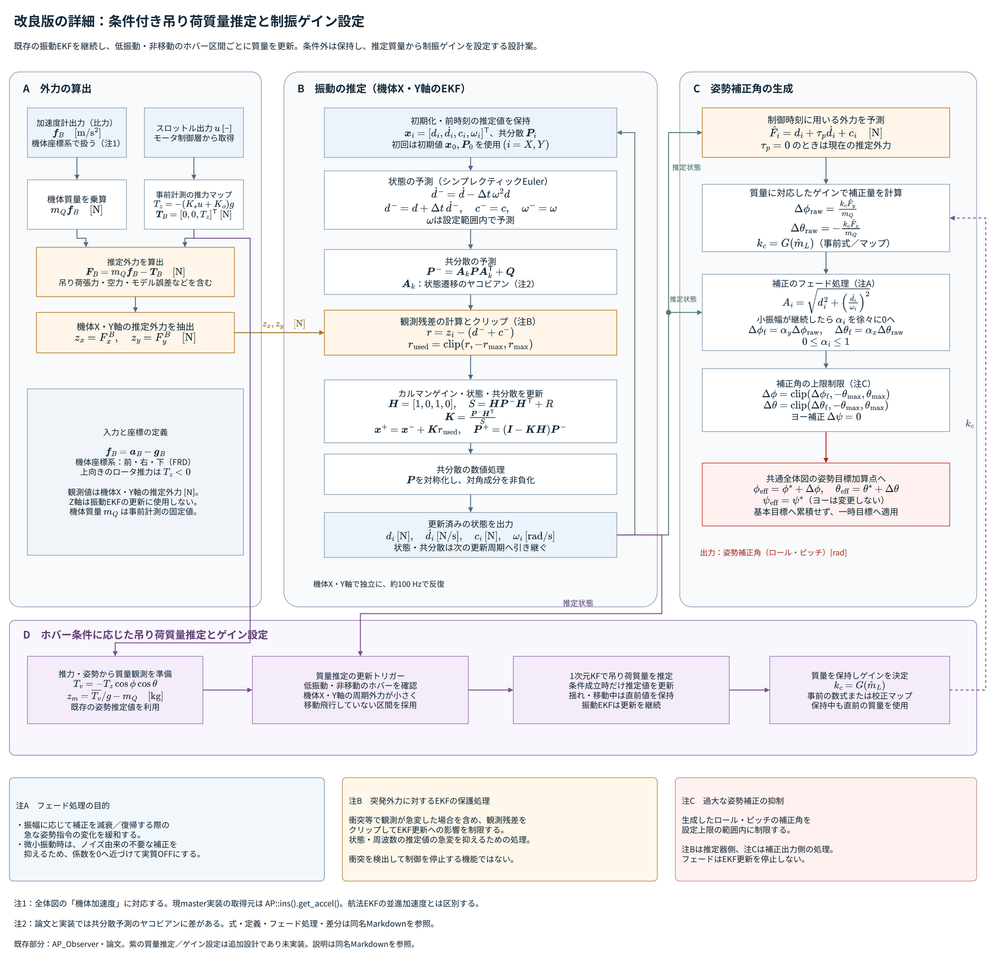

# 改良版：ホバー時の吊り荷質量推定を追加

既存版の振動EKF・姿勢補正角生成に、吊り荷質量の推定と質量に応じたゲイン設定を追加する構成案である。共通全体図と既存版の詳細図は変更していない。

- [編集用draw.io](control_detail_mass.drawio)
- [拡大用SVG](control_detail_mass.svg)
- [比較対象：既存版](control_detail_paper.drawio)

## 質量推定の更新条件

揺れが少なく、移動飛行していないホバリング区間をトリガーとして、1次元KFで吊り荷質量を更新する。機体X・Y軸の周期外力が小さいことを、低振動の確認に使う。ホバー状態の確認には既存の機体状態推定値を利用する。

揺れている区間や移動飛行中は質量を更新せず、直前の推定値を保持する。再び更新条件を満たすホバー区間に入れば更新を再開し、ピックアップ等による質量変化をその区間で反映する。振動EKFは質量更新の条件にかかわらず推定を継続する。

周期外力が小さいことだけでは移動の有無を判別できないため、非移動のホバー確認も併用する。具体的なしきい値、判定時間、平均時間、KF内部の設定は本図では扱わない。

## 質量観測とゲイン設定

事前計測の推力マップと姿勢推定値から、正の上向き鉛直推力を求める。機体FRD座標系では、次式となる。

$$
T_v=-T_z\cos\phi\cos\theta
$$

有効なホバー区間の平均推力から総質量を求め、事前計測した機体質量を差し引いて、吊り荷質量の観測値を作る。

$$
z_m=\frac{\overline{T_v}}{g}-m_Q\quad[\mathrm{kg}]
$$

この観測値を1次元KFで処理し、得られた質量から事前の数式またはマップで制振ゲインを決める。

$$
k_c=G(\hat m_L)
$$

観測値を質量へ換算したモデルは推定質量に対して線形なので、通常の1次元KFを使う構成とする。KFの内部計算式や共分散の扱いは、今回の図・説明には展開しない。一般的なKFについては [MathWorksのKalman Filtering解説](https://www.mathworks.com/help/control/ug/kalman-filtering.html) を参照できる。

保持中は直前の推定質量に対応するゲインを使用する。既存のフェード・補正角制限・姿勢目標への適用は維持し、外力算出と補正角の正規化に使う機体質量 $m_Q$ は総質量へ置き換えない。

紫色の処理は追加設計案であり、制御コードへの実装、推定精度、質量依存ゲインの検証は行っていない。ゲイン関係の具体式・マップは事前に設定する項目として残す。
