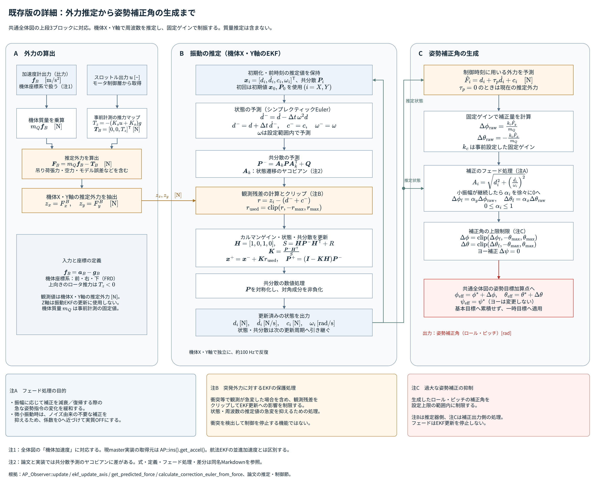

# 既存版の詳細：外力推定と姿勢補正角の生成

対象は論文方式と、それに対応する `master` の既存実装（確認時点 `c2f59a67cd`）である。共通全体図の上段にある「外力の算出」「振動・制御用パラメータの推定」「姿勢補正角の生成」を、既存版について展開する。吊り荷質量の推定・質量依存ゲインは含めない。

- [編集用draw.io](control_detail_paper.drawio)
- [拡大用SVG](control_detail_paper.svg)
- [共通全体図](control_overview.drawio)

図中の変数・式にはdraw.ioの数式表示（MathJax）を使用する。下付き・上付き、時間微分、ハット、分数、平方根はLaTeXとして保存し、数式として描画する。数式表示は有効化済みであり、編集時は「Extras → Mathematical Typesetting」で切り替えられる。[draw.io公式説明](https://www.drawio.com/docs/manual/text/math-typesetting/)

## 1. 入出力と記号

| 記号 | 内容 | 単位・定義 |
| --- | --- | --- |
| $f_B$ | 全体図で「機体加速度」と表記した入力 | $\mathrm{m/s^2}$。ここで使う式では機体座標系の比力 $f_B=a_B-g_B$ |
| $u$ | モータ制御層のスロットル出力 | 正規化値。`motors->get_throttle_out()` |
| $m_Q$ | 既知の機体質量 | $\mathrm{kg}$。吊り荷を含む総質量とは区別 |
| $T_B$ | ロータ推力ベクトル | $\mathrm{N}$。機体FRD座標系で $[0,0,T_z]^\mathsf T$ |
| $F_B$ | 算出した推定外力 | $\mathrm{N}$。吊り荷張力・空力・モデル誤差・センサ誤差等を含む |
| $z_i$ | 機体X・Y軸のEKF観測値 | $\mathrm{N}$。$i=X,Y$ |
| $d_i,\dot d_i,c_i,\omega_i$ | 周期外力、その時間微分、定常成分、角周波数 | $\mathrm{N},\mathrm{N/s},\mathrm{N},\mathrm{rad/s}$ |
| $P,Q,R$ | 状態共分散、プロセス雑音共分散、観測雑音分散 | 状態・観測に対応する共分散。$R$の単位は $\mathrm{N^2}$ |
| $\tau_p$ | 外力の予測時間 | $\mathrm{s}$。設定値0なら現在の推定外力 |
| $\alpha_i$ | フェード係数 | $0\leq\alpha_i\leq1$ |
| $k_c$ | 固定の角度変換ゲイン | $\hat F_i/m_Q$を角度へ変換する係数。式の次元では $\mathrm{rad\,s^2/m}$ |
| $\Delta\phi,\Delta\theta$ | ロール・ピッチの補正角 | $\mathrm{rad}$。ヨー補正は0 |

機体FRD座標系は前・右・下を正とする。現実装の入力取得元は `AP::ins().get_accel()` であり、航法EKFの重力除去済み並進加速度を取得する処理ではない。共通全体図の入力名は維持し、詳細図ではこの定義を注記する。重力除去済み加速度を入力する設計へ変更する場合、外力算出式も変更が必要となる。

## 2. A：外力の算出

機体に作用する運動加速度と比力の関係を $f_B=a_B-g_B$ とする。既知の機体質量と推力から推定外力を求める。

$$
F_B=m_Qf_B-T_B,\qquad T_B=[0,0,T_z]^\mathsf T
$$

既存の実測由来マップは次式である。

$$
T_z=-(K_su+K_o)g
$$

確認時の定数は $K_s=6.3157$、$K_o=-0.9995$、$g=9.7985\ \mathrm{m/s^2}$、$m_Q=1.4\ \mathrm{kg}$。$K_su+K_o$は質量相当量であり、$g$を乗じた推力の単位は $\mathrm{N}$。上向き推力は機体下向き軸に対して負である。

このモデルでは、機体座標系で $T_x^B=T_y^B=0$ なので、$F_x^B=m_Qf_x^B$、$F_y^B=m_Qf_y^B$。機体X・Y軸の振動EKFの観測値は $z_x=F_x^B$、$z_y=F_y^B$ である。上付き $B$ は機体座標系を表す。機体が傾けばX・Y軸は地面に対する水平方向と一致しない。推力マップは主に機体Z軸の推定外力に作用し、X・Y軸成分へ直接減算されるわけではない。

## 3. B：振動の推定

機体X・Y軸を独立に更新する。本図は角周波数を継続的に推定する構成を示す。各軸の状態と観測モデルは次式である。

$$
x_i=[d_i,\dot d_i,c_i,\omega_i]^\mathsf T,\qquad z_i=d_i+c_i+v_i,\qquad H=[1,0,1,0]
$$

周期外力は $\ddot d=-\omega^2d$ でモデル化する。状態数は各軸4であり、吊り荷の振れ角を直接推定するモデルではない。

### 3.1 予測と更新

1. 前時刻の状態・共分散を読み出す。初回は初期値を使用する。
2. 次式のシンプレクティックEuler法で状態を予測する。予測時の角周波数は設定範囲に制限する。

$$
\dot d^-_k=\dot d_{k-1}-\Delta t\,\omega_{k-1}^2d_{k-1},\qquad
d^-_k=d_{k-1}+\Delta t\,\dot d^-_k
$$

$$
c^-_k=c_{k-1},\qquad \omega^-_k=\omega_{k-1},\qquad P^-_k=A_kP_{k-1}A_k^\mathsf T+Q
$$

3. 観測残差を求め、大きな入力をクリップする。

$$
r_k=z_k-Hx^-_k,\qquad r_{\mathrm{used}}=\operatorname{clip}(r_k,-r_{\max},r_{\max})
$$

4. カルマンゲインを求め、状態と共分散を更新する。

$$
S_k=HP^-_kH^\mathsf T+R,\qquad K_k=P^-_kH^\mathsf T/S_k
$$

$$
x^+_k=x^-_k+K_kr_{\mathrm{used}},\qquad P^+_k=(I-K_kH)P^-_k
$$

5. 共分散を対称化し、対角成分を非負化する。更新した角周波数を含む状態と共分散を次周期へ保持する。

実装の更新間隔は通常約100 Hzであり、計算時の $\Delta t$ は0.001〜0.05秒へ制限される。Z軸は更新しない。観測分散が不正な場合の更新スキップ等の数値ガードは、図では省略する。

### 3.2 論文と実装のヤコビアン差

論文の状態遷移ヤコビアンは次式である。

$$
A_{\mathrm{paper}}=
\begin{bmatrix}
1-\Delta t^2\omega^2&\Delta t&0&-2\Delta t^2\omega d\\
-\Delta t\omega^2&1&0&-2\Delta t\omega d\\
0&0&1&0\\
0&0&0&1
\end{bmatrix}
$$

現master実装は、第1行を $[1,\Delta t,0,0]$ とする近似を使っている。図の $A_k$ は共分散予測の役割を示し、両者が完全に一致するとは扱わない。

## 4. C：姿勢補正角の生成

制御に使う外力は、更新済み状態から次式で予測する。定常成分 $c_i$ も含まれる。

$$
\hat F_i=d_i+\tau_p\dot d_i+c_i
$$

事前設定した固定ゲインを使い、補正量を計算する。

$$
\Delta\phi_{\mathrm{raw}}=\frac{k_c\hat F_y}{m_Q},\qquad
\Delta\theta_{\mathrm{raw}}=-\frac{k_c\hat F_x}{m_Q}
$$

### 4.1 フェード処理

フェードは、振動振幅に応じて補正を弱めたり戻したりする際に、係数を滑らかに変えて姿勢指令の急変を緩和するための処理である。また、微小振動時にノイズ由来の不要な補正が機体へ加わることを抑えるため、小振幅が継続した場合は補正を実質的にOFFにする。ここでいう振幅は、吊り荷の振れ角そのものではなく、推定外力の周期成分の振幅である。これらは実装から読み取れる処理の目的であり、全条件で不安定化を防止するという実験的保証ではない。

各軸の周期成分の振幅を $A_i=\sqrt{d_i^2+(\dot d_i/\omega_i)^2}$ とする。振幅が閾値未満ならタイマを加算し、それ以外ではリセットする。小振幅が設定時間を超えて継続した場合、フェードの目標値 $b_i$ を0、それ以外では1とする。

$$
\beta_i=\frac{\Delta t}{\Delta t+\tau_i},\qquad
\alpha_i\leftarrow\alpha_i+\beta_i(b_i-\alpha_i)
$$

$\tau_i$ は増加時と減少時で別の設定値を使用する。実装では $\beta_i$ を0〜1へ制限し、角周波数の除算を保護する。フェードは補正の振幅を滑らかに変える処理であり、小振幅時にEKF全体を自動停止する処理ではない。

### 4.2 突発外力に対する処理の区別

| 処理 | 作用する場所 | 実装から確認できる役割 |
| --- | --- | --- |
| 観測残差クリップ | EKFの状態更新前 | 衝突等で観測が急変した場合を含め、更新に使う残差を制限し、状態・周波数推定への過大な影響を抑える |
| フェード | 姿勢補正量への乗算 | 振幅に応じた補正の減衰・復帰を滑らかにし、小振幅が続いた場合に補正を弱める |
| 補正角の上限制限 | 補正角の出力 | 生成された補正角の絶対値が設定値を超えないよう制限する |

突発外力へのEKF側の対策は、Bの観測残差クリップである。状態更新は $x^+=x^-+Kr_{\mathrm{used}}$ なので、$r_{\mathrm{used}}$ を制限することで、観測残差による1回の更新への影響を抑える。状態予測やカルマンゲインそのものを一律に制限する処理ではない。観測残差の閾値には `EKF_INN_MAX` を使う。

衝突という事象を検出して制御を停止したり、回避行動を起こしたりする専用機構は、この処理には含まれない。衝突例を含む性能検証は本資料作成では行っていない。論文も、衝撃的な外乱による推定値の発散を抑える目的としてinnovation clippingを記述している。

### 4.3 上限制限と適用

$$
\Delta\phi=\operatorname{clip}(\alpha_y\Delta\phi_{\mathrm{raw}},-\theta_{\max},\theta_{\max}),\qquad
\Delta\theta=\operatorname{clip}(\alpha_x\Delta\theta_{\mathrm{raw}},-\theta_{\max},\theta_{\max})
$$

現在のCopter接続では、一時的な有効姿勢目標へロール・ピッチ補正を加える。

$$
\phi_{\mathrm{eff}}=\phi^*+\Delta\phi,\qquad
\theta_{\mathrm{eff}}=\theta^*+\Delta\theta,\qquad
\psi_{\mathrm{eff}}=\psi^*
$$

基本姿勢目標へ補正を累積しない。論文本文は補正クォータニオンの乗算を記述しているが、現在の接続はEuler角補正を受け渡す経路であり、図では現実装の処理を示す。

## 5. EKFを採用した理由と代替候補

未知の角周波数を状態に含めると $-\omega^2d$ は状態に対して非線形になる。EKFは、この小規模な非線形モデルで振動成分・定常成分・角周波数を逐次推定するために採用されている。索長を事前に与える必要がなく、機体X・Y軸で各4状態として構成できる。残差クリップとフェードは、EKFの基本原理に追加された実装上の処理である。

| 代替候補 | 主な特徴 | この用途で比較する点 |
| --- | --- | --- |
| 固定周波数の線形KF | 周波数が既知なら線形モデルになる | 索長変更や周波数ずれへの対応。本図の周波数推定EKFと比較する代替候補 |
| 同じ4状態モデルのUKF | ヤコビアンを陽に計算せず非線形変換を扱う | 計算量、初期値・雑音設定、推定精度 |
| 非線形振子モデルのEKF | 振れ角などの物理状態を推定対象にできる | 必要パラメータ、状態数、モデル誤差、可観測性 |
| 適応周波数推定・PLL等 | 周波数・位相の追従に焦点を当てられる | 振幅・定常成分の分離、励振、複数周波数への対応 |
| FFT・短時間FFTとフィルタ | 観測窓内の卓越周波数を評価する | 窓長と遅延、制御用の瞬時外力・位相の生成 |
| 外乱オブザーバ・ESO | 合成外乱の推定と制御に使う | 周期成分・定常成分・周波数を分けるための追加設計 |

上表は比較候補の整理であり、これらの代替法を同一機体・同一条件で比較した結果ではない。

## 6. 根拠と確認範囲

- [論文：外力算出と推力モデル](/home/taki/EKF-LogAnalyzer/paper/ISA_Trans_Submission/chapters/ch2_modeling.tex)
- [論文：振動EKF](/home/taki/EKF-LogAnalyzer/paper/ISA_Trans_Submission/chapters/ch3_observer.tex)
- [論文：補正角と統合](/home/taki/EKF-LogAnalyzer/paper/ISA_Trans_Submission/chapters/ch4_control.tex)
- [EKF予測・更新・フェードの実装](/home/taki/Ardupilot-UmemotoLab-ekf-V2/libraries/AP_Observer/AP_Observer.cpp:259)
- [観測残差のクリップと状態更新](/home/taki/Ardupilot-UmemotoLab-ekf-V2/libraries/AP_Observer/AP_Observer.cpp:350)
- [振幅に基づくタイマとフェード係数の更新](/home/taki/Ardupilot-UmemotoLab-ekf-V2/libraries/AP_Observer/AP_Observer.cpp:419)
- [入力取得・外力算出の実装](/home/taki/Ardupilot-UmemotoLab-ekf-V2/libraries/AP_Observer/AP_Observer.cpp:448)
- [固定ゲインによる補正角生成](/home/taki/Ardupilot-UmemotoLab-ekf-V2/libraries/AP_Observer/AP_Observer.cpp:500)
- [予測外力の計算](/home/taki/Ardupilot-UmemotoLab-ekf-V2/libraries/AP_Observer/AP_Observer.cpp:545)
- [姿勢目標への適用](/home/taki/Ardupilot-UmemotoLab-ekf-V2/libraries/AC_AttitudeControl/AC_AttitudeControl.cpp:1002)

draw.ioのXML・接続先と画像の表示を確認する資料作成であり、制御コードの変更や飛行性能の検証は行っていない。共通全体図は変更しない。
